<p align="center">
  
</p>

<h1 align="center">Minecraft Helper 3.0</h1>

<p align="center">
  Dwie niezależne aplikacje dla Minecraft 1.8.8: lekki <strong>Auto Clicker</strong> do PVP i <strong>Kopacz</strong> do kopania z Auto EQ, ochroną, wieloma kontami i botem Discord.
</p>

<p align="center">
  <strong>Windows 10/11</strong> · <strong>Minecraft 1.8.8 / BlazingPack</strong> · <strong>bez Forge i modów</strong> · <strong>wersja 3.0</strong>
</p>

<p align="center">
  <a href="#szybki-start">Szybki start</a> ·
  <a href="#auto-clicker">Auto Clicker</a> ·
  <a href="#kopacz">Kopacz</a> ·
  <a href="#bot-discord">Bot Discord</a> ·
  <a href="#instalacja">Instalacja</a> ·
  <a href="#budowanie-ze-źródeł">Budowanie</a> ·
  <a href="#zmiany-w-wersji-30">Zmiany</a>
</p>

<p align="center">
  <a href="docs/images/v3-clicker-main.png">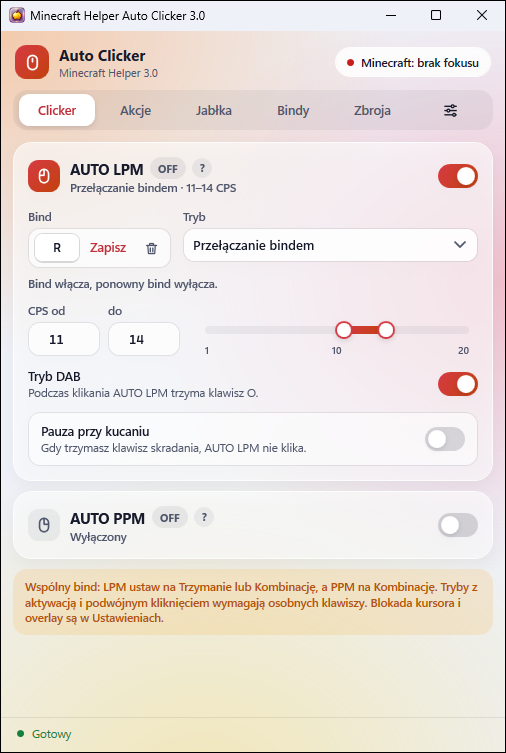</a>
  <a href="docs/images/v3-miner-mining.png">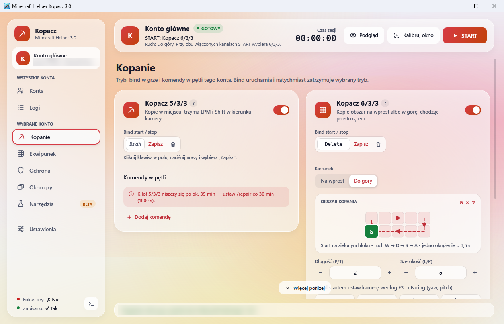</a><br>
  <sub>Auto Clicker (po lewej) i Kopacz — oba w szklanym motywie, z trzema kolorami akcentu do wyboru.</sub>
</p>

| Aplikacja | Do czego służy |
| --- | --- |
| **Auto Clicker** | AUTO LPM i AUTO PPM z kilkoma trybami, szybkie akcje PVP (blok, śnieżka, perła, wędka), Auto Guard, zamrożenie okna, BINDY z komendami, Auto zbroja i ścinanie jabłek. |
| **Kopacz** | Kopanie 5/3/3 i 6/3/3 (także w tle), Auto EQ z CobbleX, jedzeniem i wpłatą złota, ochrona po dźwięku obrażeń, Auto Reconnect z `/home`, wiele kont naraz, bot Discord, logi i menu developera z testami. |

Aplikacje instalujesz razem albo osobno; każda ma własne ustawienia, ikonę i aktualizacje. Auto Clicker nie ładuje OCR, dźwięku ani mechanizmów Kopacza, a Kopacz nie ma clickerów ani globalnego hooka myszy.

> [!IMPORTANT]
> Obie aplikacje wysyłają klawisze i kliknięcia do wybranej gry. Zanim cokolwiek uruchomisz, sprawdź, czy wybrany jest właściwy proces Minecrafta. Automatyzacja może być niezgodna z zasadami Twojego serwera — korzystasz z niej na własną odpowiedzialność.

## Szybki start

1. **Zainstaluj** — uruchom [instalator](#instalacja) i wybierz Auto Clicker, Kopacza albo oba. Możesz też [zbudować projekt ze źródeł](#budowanie-ze-źródeł).
2. **Uruchom grę** — Minecraft albo BlazingPack w wersji **1.8.8**, i wejdź na serwer.
3. **Wybierz grę w programie** — w Auto Clickerze w ustawieniach (ikona suwaków), w Kopaczu w zakładce **Okno gry**. Obie aplikacje pokazują tylko procesy gry, nigdy launcher ani inne programy.
4. **Włącz paczkę zasobów** (tylko Kopacz) — Kopacz sam ją tworzy; w grze włącz `MinecraftHelper AutoEQ + CobbleX (1.8.8)` na samej górze listy i ustaw `GUI Scale: Large`. Szczegóły: [paczka zasobów](#paczka-zasobów).
5. **Ustaw bindy i sprawdź w bezpiecznym miejscu** — każdy moduł uruchamiasz zapisanym bindem; podpowiedzi są pod przyciskami `?`.

Przy pierwszym uruchomieniu i po aktualizacji każda aplikacja pokazuje okno „Co nowego”. Przy starcie obie sprawdzają najnowsze wydanie na GitHubie i tylko informują o nowej wersji — niczego nie pobierają same.

## Auto Clicker

Małe, pionowe okno z zakładkami **Clicker**, **Akcje**, **Jabłka**, **Bindy**, **Zbroja** i ustawieniami. Clicker klika tylko wtedy, gdy wybrana gra jest na wierzchu, a blokada kursora wstrzymuje wszystko przy otwartym ekwipunku, czacie i menu.

### Wybór gry

Auto Clicker trzyma się **procesu gry**, a nie pojedynczego okna — działa więc na pełnym ekranie, po `F11` i `Alt+Tab`, a utrata fokusu nie kasuje wyboru. Lista pokazuje tylko okna gry (LWJGL/GLFW), nigdy samego Auto Clickera, Kopacza ani przeglądarki z „Minecraft” w tytule. Gra uruchomiona po Clickerze jest wykrywana sama.

<p align="center">
  <a href="docs/images/v3-clicker-settings.png">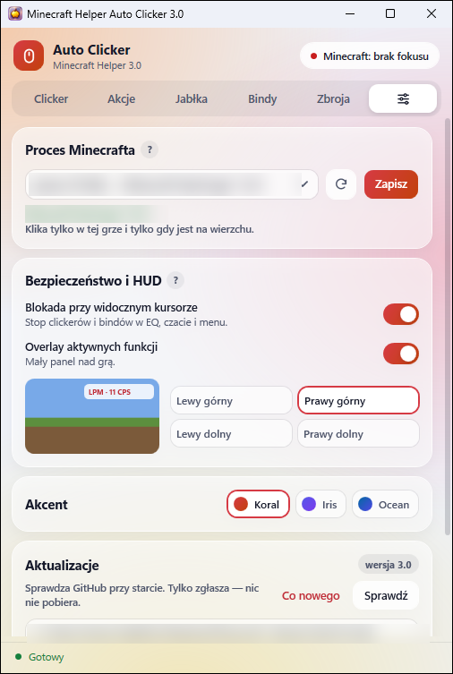</a><br>
  <sub>Ustawienia: proces gry, blokada kursora, overlay nad grą, kolor akcentu i aktualizacje.</sub>
</p>

### AUTO LPM i AUTO PPM

Każdy kanał ma bind, zakres CPS (od–do) i jeden z trybów:

| Tryb | Działanie |
| --- | --- |
| Przełączanie bindem | bind włącza, ponowny bind wyłącza |
| Działa podczas trzymania bindu | klika, dopóki trzymasz klawisz |
| Bind + fizyczny LPM/PPM | klika, gdy trzymasz bind i przycisk myszy |
| Aktywacja bindem + trzymanie LPM/PPM | bind uzbraja moduł, a klikanie trwa tylko przy trzymanym przycisku myszy |
| Podwójne kliknięcie | do Twojego kliknięcia dokłada drugie po ustawionym czasie |

- **Tryb DAB** przytrzymuje klawisz `O` podczas klikania AUTO LPM.
- **Pauza przy kucaniu** wstrzymuje AUTO LPM, gdy trzymasz klawisz skradania.
- Pierwsze kliknięcie pada od razu, a puszczenie bindu zatrzymuje kanał przed następnym. Dokładny zegar Windows działa tylko podczas klikania.

### Akcje PVP

<p align="center">
  <a href="docs/images/v3-clicker-actions.png">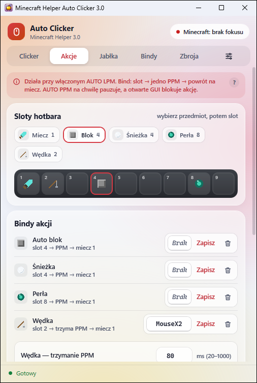</a><br>
  <sub>Sloty hotbara i osobne bindy szybkich akcji.</sub>
</p>

- **Szybkie akcje** — auto blok, śnieżka, perła i wędka: przy aktywnym AUTO LPM bind wybiera przedmiot, robi jedno użycie PPM i wraca na miecz. AUTO LPM nie traci rytmu; wędka ma ustawiany czas trzymania PPM (20–1000 ms).
- **Auto Guard** (blockhit) — bind włącza tapowanie PPM równolegle z AUTO LPM. Po rzucie perłą lub śnieżką czeka 2 s, żeby blok nie anulował rzutu.
- **Zamrożenie okna** — wstrzymuje wątek gry, dopóki trzymasz bind.

> [!WARNING]
> Auto Guard i zamrożenie okna mogą zostać wykryte przez antycheat serwera.

Utrata fokusu, otwarte GUI albo wyłączenie clickera przerywają akcję i zwalniają PPM. Aktualny etap widać w overlayu nad grą.

### Ścinanie jabłek

Osobny bind uruchamia i zatrzymuje pętlę: nożyce i LPM przez losowy czas, potem liście kładzione z prędkością 40 CPS. Sloty nożyc i liści oraz zakresy czasów ustawiasz sam; co ustawioną liczbę cykli (domyślnie 40) program wykonuje `/repair`. Utrata fokusu albo nieoczekiwane GUI przerywa pętlę.

### BINDY

<p align="center">
  <a href="docs/images/v3-clicker-binds.png">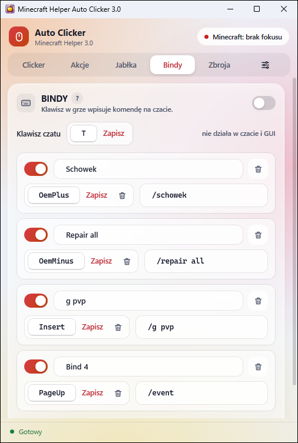</a><br>
  <sub>Własne komendy pod klawiszami.</sub>
</p>

Każdy wpis ma nazwę, bind i komendę. Po naciśnięciu binda program otwiera czat, wpisuje komendę i zatwierdza ją `Enterem`. Bindy nie działają, gdy piszesz na czacie albo masz otwarte GUI.

### Auto zbroja

<p align="center">
  <a href="docs/images/v3-clicker-armor.png">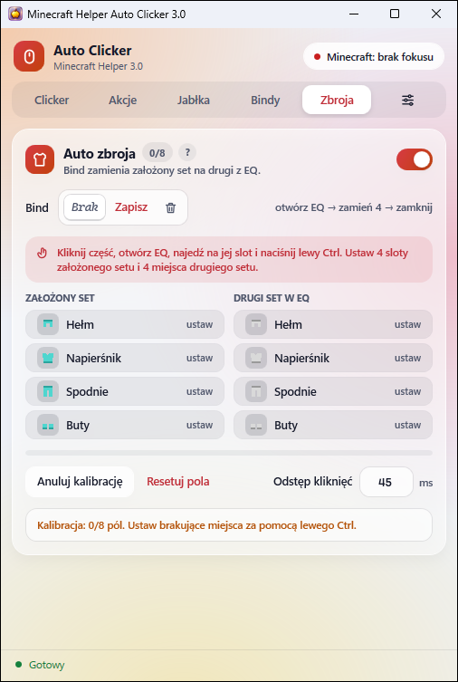</a><br>
  <sub>Kalibracja założonego setu i drugiego setu w ekwipunku.</sub>
</p>

Bind zamienia założony komplet z drugim setem z ekwipunku. Raz kalibrujesz osiem miejsc (cztery części założone i cztery w EQ): klikasz pole, w grze najeżdżasz na slot i naciskasz lewy `Ctrl`. Odstęp między kliknięciami ustawisz w zakresie 25–200 ms (domyślnie 45 ms). Po zmianie rozdzielczości, rozmiaru okna albo `GUI Scale` skalibruj pola ponownie.

## Kopacz

Okno z paskiem bocznym: **Konta** i **Logi** dotyczą wszystkich kont, a **Kopanie**, **Ekwipunek**, **Ochrona**, **Okno gry**, **Narzędzia** i **Ustawienia** — wybranego konta. Pasek u góry pokazuje stan konta, czas sesji i przycisk START.

### Kopanie

- **Kopacz 5/3/3** — kopie w miejscu: trzyma LPM i Shift w kierunku kamery.
- **Kopacz 6/3/3** — kopie obszar na wprost albo do góry, chodząc prostokątem. Edytor obszaru pokazuje każdy blok jako kratkę, start i drogę `W → D → S → A` oraz czas okrążenia; długość i szerokość zmieniasz przyciskami −/+.
- **Komendy w pętli** — np. `/repair` co 30 min; każda komenda ma własny odstęp liczony od poprzedniej. Podczas Auto EQ odliczanie stoi.

Każdy kanał ma bind start/stop. Gdy włączone są oba, przycisk START uruchamia 6/3/3.

### Ekwipunek: Auto EQ, CobbleX i złoto

<p align="center">
  <a href="docs/images/v3-miner-inventory.png">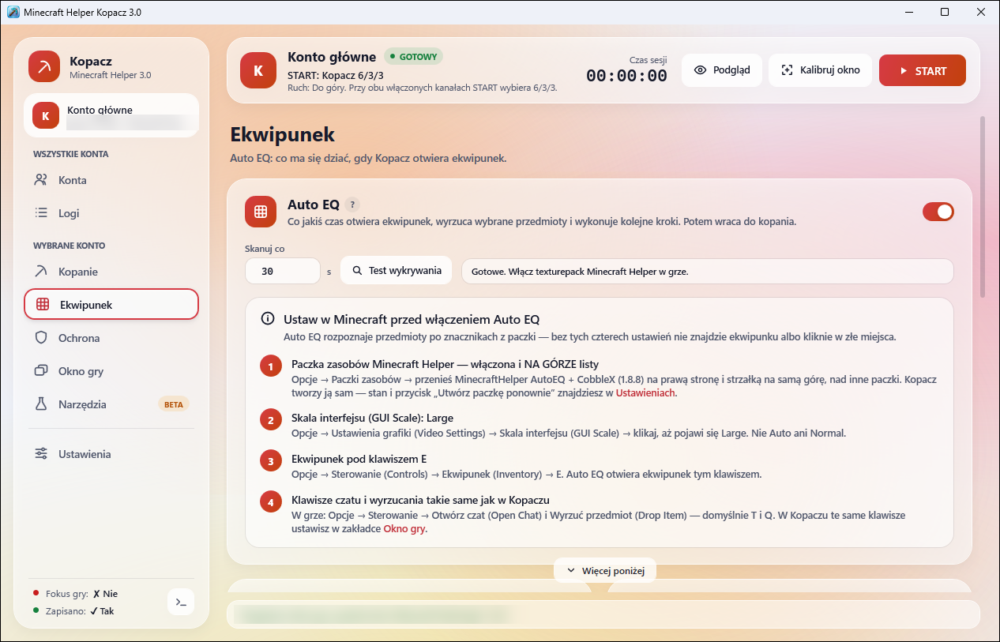</a><br>
  <sub>Auto EQ z listą ustawień, które trzeba mieć w grze.</sub>
</p>

**Auto EQ** co ustawiony czas otwiera ekwipunek, rozpoznaje przedmioty po znacznikach z paczki i wyrzuca całe stosy z wybranych pól (`lewy Ctrl + klawisz wyrzucania`). Sprawdza wynik ponownym skanem i robi do trzech przebiegów. Hotbar, pancerz i crafting nie są ruszane. Rozpoznaje m.in. diamenty, złoto, żelazo, emeraldy (sztabki i bloki), obsydian, jabłka, piasek, proch, węgiel, kwarc, książki, perły i redstone. Tryb „wyrzucaj wszystko” zostawia tylko cobblestone.

Po skanie, w tej kolejności:

1. **CobbleX** — po zebraniu ustawionej liczby pełnych stacków cobblestone (domyślnie 9) program wysyła komendę serwera (domyślnie `/cx`), opcjonalnie 3 razy.
2. **Wpłata złota** — wpisuje komendę banku lub bazaru, rozpoznaje menu po tytule i przenosi bloki i sztabki złota do wybranego pola. Przy odrzuceniu odkłada stos i zatrzymuje kopanie. [Pierwsza próba krok po kroku](tests/GoldDeposit/README.md).
3. **Jedzenie** — slot 2, 4 s PPM, powrót na slot 1.
4. Wznowienie kopania.

#### Paczka zasobów

Rozpoznawanie przedmiotów wymaga paczki `MinecraftHelper AutoEQ + CobbleX (1.8.8)`. **Kopacz tworzy ją sam** przy starcie — z oryginalnych tekstur Twojej gry (`%APPDATA%\.minecraft\versions\1.8.8\1.8.8.jar`) — i zapisuje w `%APPDATA%\.minecraft\resourcepacks`. Nie trzeba niczego pobierać; repozytorium nie zawiera tekstur Minecrafta. Paczka ma też dźwięki obrażeń `hit1–hit4` używane przez ochronę. Stan i ponowne utworzenie znajdziesz w **Ustawienia → Paczka zasobów**.

W grze:

1. włącz paczkę i przesuń ją **na samą górę** listy,
2. ustaw `GUI Scale: Large`,
3. ekwipunek zostaw pod klawiszem `E`, a klawisze czatu i wyrzucania ustaw tak samo jak w Kopaczu (domyślnie `T` i `Q`).

Jeśli gry 1.8.8 jeszcze nie ma, uruchom ją raz z launchera — Kopacz utworzy paczkę przy następnym starcie.

### Ochrona i Auto Reconnect

<p align="center">
  <a href="docs/images/v3-miner-protection.png">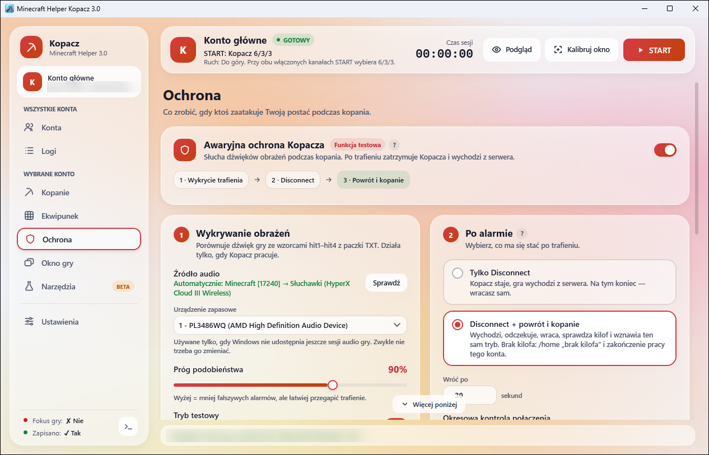</a><br>
  <sub>Awaryjna ochrona: wykrycie trafienia → Disconnect → powrót i kopanie.</sub>
</p>

**Awaryjna ochrona** nasłuchuje dźwięku gry podczas kopania i porównuje go ze wzorcami `hit1–hit4`. Po trafieniu:

1. zatrzymuje kopanie i wychodzi z serwera (`ESC → Disconnect`),
2. w trybie **Disconnect + powrót** po ustawionym czasie wraca na serwer (Direct Connect z profilu),
3. otwiera EQ i szuka diamentowego kilofa,
4. jest kilof → `/home` z profilu (z wyborem pola w GUI, jeśli trzeba), teleport i wznowienie tego samego trybu kopania;
   brak kilofa → osobny home „brak kilofa” i koniec pracy konta.

**Tryb testowy** tylko zapisuje alarm, bez wychodzenia z serwera — zacznij od niego.

**Auto Reconnect** rozpoznaje ekrany gry i reaguje:

- **menu główne** → klika `Multiplayer`,
- **ekran rozłączenia** (np. `Disconnected by Server`) → po 10 s `Back to server list`, potem `F5` i ponowne wejście,
- **lista serwerów** → `Direct Connect` z adresem z profilu,
- **po wejściu** → 3 s na załadowanie serwera, `/home` i kontrola EQ,
- **ekran bana albo nieznany** → zatrzymuje się bez klikania.

Profil powrotu (osobny dla każdego serwera) zawiera adres, komendę home, opcjonalne pole w GUI, czasy i liczbę prób. Pozycje przycisków są liczone jak w Minecrafcie 1.8.8, z faktyczną skalą GUI okna.

> [!NOTE]
> Ochrona i reconnect to funkcje testowe. Przed użyciem bez nadzoru sprawdź cały przebieg testem **Pełny cykl z kopaniem** w [menu developera](#menu-developera).

### Okno gry i kopanie w tle

<p align="center">
  <a href="docs/images/v3-miner-window.png">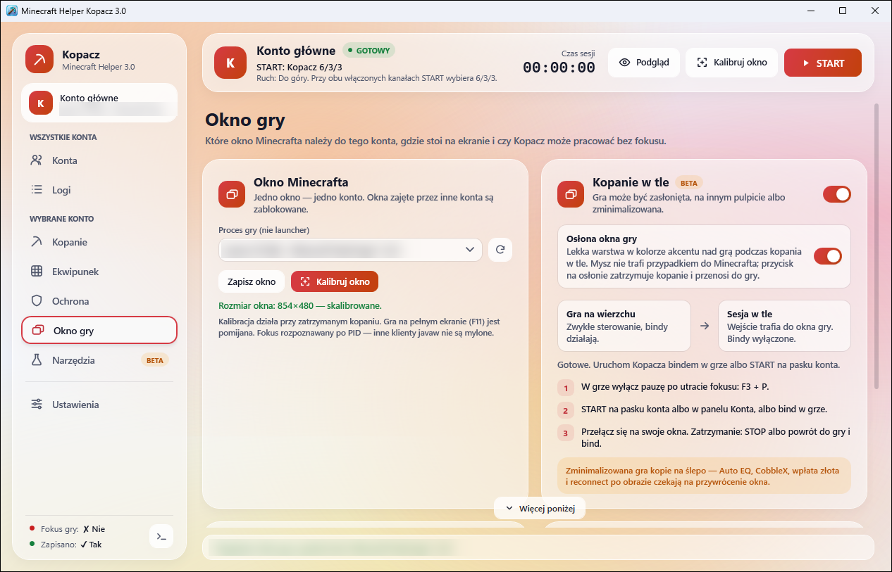</a><br>
  <sub>Wybór okna gry, kalibracja 854×480 i kopanie w tle.</sub>
</p>

- **Okno Minecrafta** — jedno okno to jedno konto; okna zajęte przez inne konta są zablokowane.
- **Kalibruj okno** — ustawia okno gry na 854×480 obok okien pozostałych kont.
- **Kopanie w tle (beta)** — Kopacz steruje grą bez fokusu, więc możesz pracować w innych programach. Gra może być zasłonięta, na innym pulpicie albo zminimalizowana. Zminimalizowana gra kopie na ślepo: Auto EQ, CobbleX, wpłata złota i reconnect czekają na przywrócenie okna. Opcjonalna **osłona okna** chroni grę przed przypadkowym kliknięciem.

W grze wyłącz pauzę po utracie fokusu (`F3 + P`).

### Wiele kont

<p align="center">
  <a href="docs/images/v3-miner-accounts.png">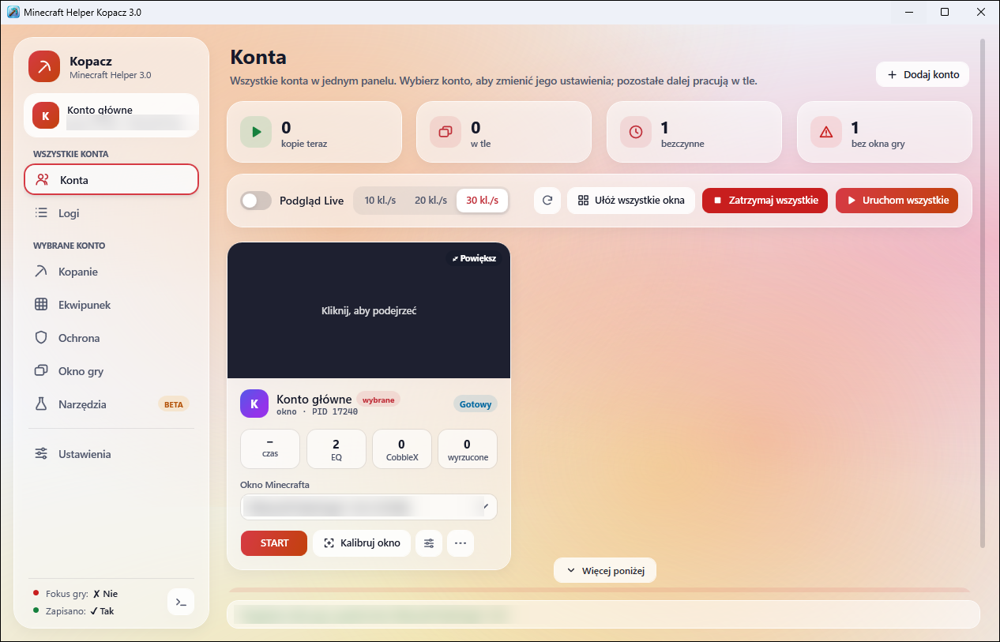</a><br>
  <sub>Panel kont z podglądem Live, układaniem okien i startem wszystkich kont.</sub>
</p>

Każde konto to osobny proces z własnymi ustawieniami, logami i oknem gry — awaria jednego nie zatrzymuje pozostałych. Panel pokazuje stan wszystkich kont, opcjonalny podgląd Live (10–30 kl./s, tylko lokalnie), przyciski **Ułóż wszystkie okna**, **Uruchom wszystkie** i **Zatrzymaj wszystkie**. Szczegóły: [docs/MULTI_ACCOUNT.md](docs/MULTI_ACCOUNT.md).

### Logi

<p align="center">
  <a href="docs/images/v3-miner-logs.png">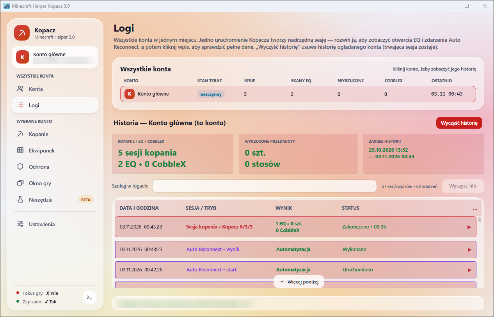</a><br>
  <sub>Historia wszystkich kont: sesje, skany EQ, CobbleX, reconnect i ochrona.</sub>
</p>

Jedno uruchomienie Kopacza to jedna sesja. Po rozwinięciu widać kolejne skany EQ, CobbleX, wpłaty złota, reconnecty, alarmy ochrony i powroty na home, a po kliknięciu wpisu — pełne szczegóły (sloty, wyrzucone sztuki i stosy, co zostało). Wyszukiwarka filtruje po każdym polu, **Zapisz raport** eksportuje widoczne wpisy do CSV albo TXT, a **Wyczyść historię** czyści historię oglądanego konta.

### Narzędzia (beta)

**Auto łowienie** pilnuje czerwonej części spławika w zaznaczonym obszarze i zwija wędkę po braniu. Opcjonalnie co ustawiony czas wysyła komendę naprawy. Działa tylko z grą na wierzchu.

### Ustawienia

<p align="center">
  <a href="docs/images/v3-miner-settings.png">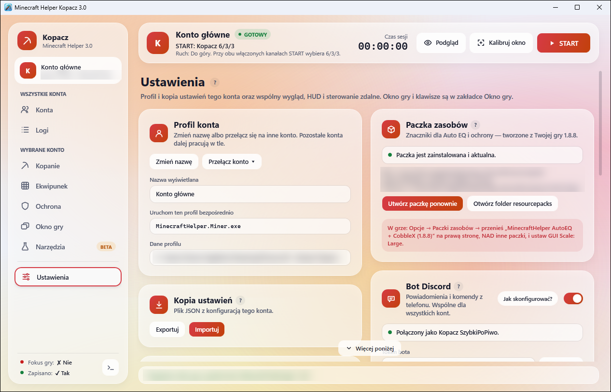</a><br>
  <sub>Profil konta, kopia ustawień, paczka zasobów i bot Discord.</sub>
</p>

- **Profil konta** — nazwa wyświetlana i przełączanie kont.
- **Kopia ustawień** — eksport i import pliku JSON.
- **Paczka zasobów** — stan, ponowne utworzenie i folder `resourcepacks`.
- **Wygląd** — akcent Iris, Koral albo Ocean i animowane tło.
- **HUD nad grą** — panel z etapem pracy, czasem, wynikami EQ i odliczaniem ochrony; wybór monitora i narożnika.
- **Bot Discord** — zobacz [niżej](#bot-discord).
- **Menu developera** — zobacz [niżej](#menu-developera).

### Bot Discord

<p align="center">
  <a href="docs/images/v3-miner-discord.png">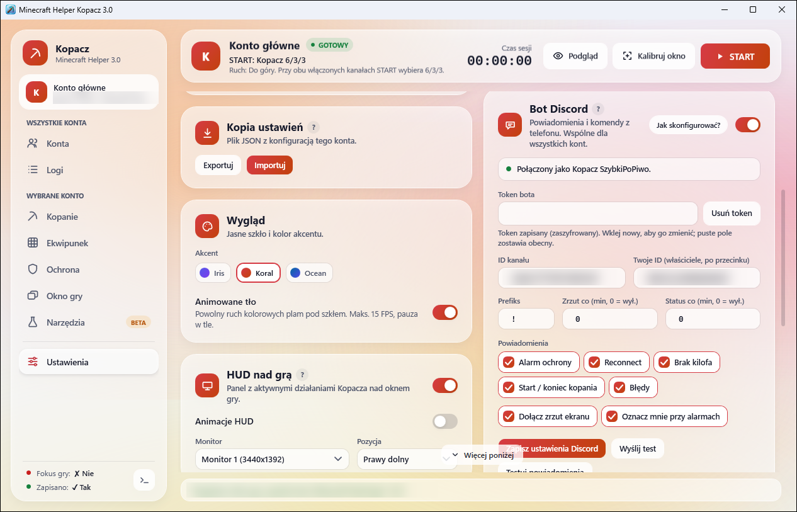</a>
  <a href="docs/images/v3-miner-commands.png">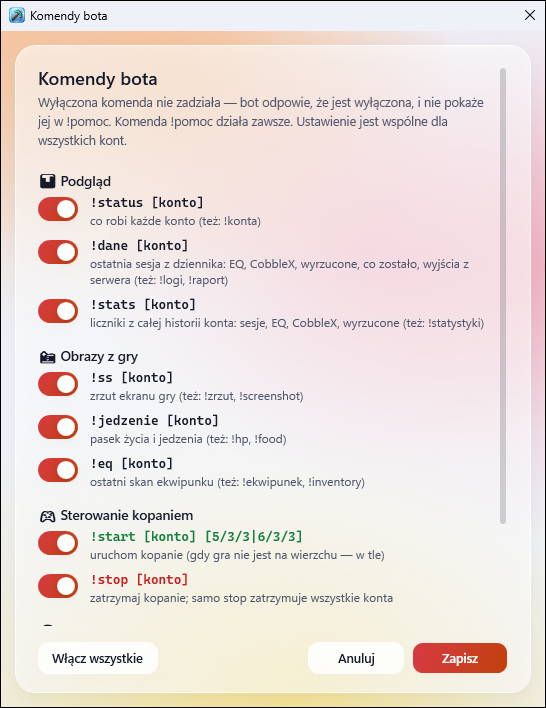</a><br>
  <sub>Karta bota i okno włączania komend.</sub>
</p>

Własny bot na Twoim serwerze Discord wysyła powiadomienia i przyjmuje komendy z telefonu. Przycisk **Jak skonfigurować?** prowadzi krok po kroku: od utworzenia bota w Developer Portal po pierwszą komendę. Bot działa tylko w Kopaczu.

**Powiadomienia** (każde można wyłączyć): alarm ochrony, reconnect, brak kilofa, start i koniec kopania z podsumowaniem sesji oraz błędy. Karty mają zrzut ekranu z gry, robiony dopiero, gdy ekran pokazuje skutek akcji, a przy alarmach — oznaczenie właściciela. **Testuj powiadomienia** wysyła przykład każdej karty.

**Komendy** przyjmuje tylko od wpisanych właścicieli, na ustawionym kanale albo w wiadomości prywatnej:

| Komenda | Działanie |
| --- | --- |
| `!pomoc` | lista włączonych komend |
| `!status [konto]` | co robi każde konto |
| `!dane [konto]` | ostatnia sesja z dziennika: EQ, CobbleX, wyrzucone, co zostało, wyjścia z serwera |
| `!stats [konto]` | liczniki z całej historii konta |
| `!ss` / `!jedzenie` / `!eq [konto]` | zrzut ekranu, pasek życia i jedzenia, ostatni skan ekwipunku |
| `!start [konto] [5/3/3\|6/3/3]` | uruchom kopanie (bez gry na wierzchu — w tle) |
| `!stop [konto]` | zatrzymaj kopanie; samo `!stop` zatrzymuje wszystkie konta |
| `!join [konto] [5/3/3\|6/3/3]` | wejdź na serwer jak Auto Reconnect (lista serwerów, Direct Connect, `/home`, kontrola EQ) i zacznij kopać |
| `!leave [konto]` | zatrzymaj kopanie i wyjdź z serwera |

**Włącz / wyłącz komendy** otwiera okno z przełącznikiem przy każdej komendzie — wyłączona komenda nie działa i znika z `!pomoc`. Token bota jest zaszyfrowany kluczem Twojego konta Windows (DPAPI) i nie trafia do ustawień ani logów.

### Menu developera

<p align="center">
  <a href="docs/images/v3-miner-developer.png">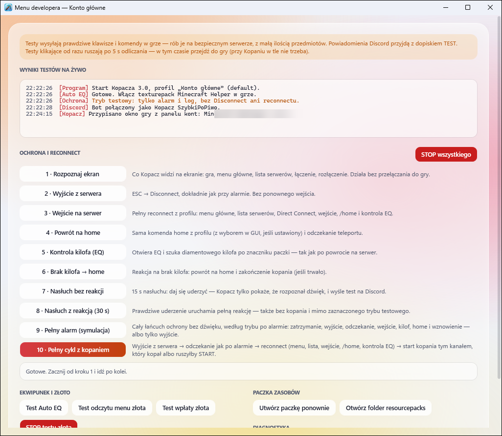</a><br>
  <sub>Osobne okno z testami każdego etapu i dziennikiem na żywo.</sub>
</p>

**Otwórz menu developera** (w Ustawieniach albo w zakładce Ochrona) otwiera osobne okno, które możesz trzymać obok gry. W środku są:

- testy ochrony i reconnectu: rozpoznanie ekranu, wyjście z serwera, wejście, home, kontrola kilofa, brak kilofa, nasłuch, pełny alarm i pełny cykl z kopaniem,
- testy Auto EQ i wpłaty złota,
- testy bota Discord,
- paczka zasobów i konsola zdarzeń.

Testy wysyłają prawdziwe klawisze i komendy — rób je na bezpiecznym serwerze. W dzienniku są oznaczone jako `Test:`, więc nie liczą się do statystyk.

## Pliki i zasobnik

Ustawienia zapisują się automatycznie:

```text
%APPDATA%\Minecraft Helper\
├── AutoClicker\settings.json
├── Kopacz\settings.json          ← konto główne
├── Kopacz\Profiles\<konto>\      ← pozostałe konta
├── Kopacz\discord.json           ← bot Discord (token zaszyfrowany)
└── mining-logs.json              ← logi konta głównego
```

Przycisk `X` w obu aplikacjach nie kończy programu — chowa okno do zasobnika obok zegara, a włączone funkcje działają dalej. Program zamkniesz z menu ikony w zasobniku.

## Instalacja

Pobierz `MinecraftHelper-Setup-3.0.exe` z [wydań na GitHubie](https://github.com/SzybkiPoPiwo/Minecraft-Helper-3.0/releases) i uruchom. Na ekranie składników wybierz **Auto Clicker**, **Kopacza** albo oba. Instalator działa dla bieżącego użytkownika, nie wymaga osobnej instalacji .NET i dodaje zwykły deinstalator Windows. Starszą, połączoną wersję programu wykrywa sam i prowadzi przez migrację; ustawienia zostają zachowane.

Przed aktualizacją zamknij obie aplikacje z menu zasobnika. Sumę SHA-256 oficjalnego pliku znajdziesz w opisie wydania; dla pliku pobranego sprawdzisz ją poleceniem:

```powershell
Get-FileHash .\MinecraftHelper-Setup-3.0.exe -Algorithm SHA256
```

### Windows SmartScreen i Smart App Control

Instalator nie ma komercyjnego podpisu, więc Windows może go uznać za nierozpoznaną aplikację. Sam brak reputacji nie oznacza wirusa — upewnij się tylko, że plik pochodzi z tego repozytorium. W oknie SmartScreen kliknij `Więcej informacji` → `Uruchom mimo to`.

`Inteligentna kontrola aplikacji` (Smart App Control) w Windows 11 może całkowicie blokować niepodpisane programy. Najbezpieczniej jest wtedy [zbudować aplikacje samodzielnie](docs/BUILDING.md). Nie wyłączaj antywirusa ani zapory. Więcej: [Smart App Control — FAQ](https://support.microsoft.com/pl-pl/windows/security/threat-malware-protection/smart-app-control-frequently-asked-questions).

## Budowanie ze źródeł

Wymagane: Windows 10/11 i .NET SDK obsługujący pliki `.slnx` (sprawdzone na SDK 10.0.402; aplikacje celują w .NET 8). Inno Setup 6 jest potrzebny tylko do instalatora. Pełna instrukcja: [docs/BUILDING.md](docs/BUILDING.md).

```powershell
git clone https://github.com/SzybkiPoPiwo/Minecraft-Helper-3.0.git
cd Minecraft-Helper-3.0
dotnet build .\MinecraftHelper.slnx -c Release
```

Uruchomienie wybranej aplikacji:

```powershell
dotnet run --project ".\MinecraftHelper.Pvp\MinecraftHelper.Pvp.csproj" -c Release   # Auto Clicker
dotnet run --project ".\MinecraftHelper\MinecraftHelper.csproj" -c Release           # Kopacz
```

Instalator:

```powershell
.\scripts\build-installer.ps1 -Version 3.0 -Rid win-x64
```

Testy regresji (bez uruchamiania gry; test `GoldDeposit` korzysta z zainstalowanej gry 1.8.8):

```powershell
.\scripts\test.ps1
```

Generator paczki zasobów jest w [MarkerResourcePack.cs](MinecraftHelper/Services/MarkerResourcePack.cs). Po zmianie znaczników podnieś `GeneratorVersion` — Kopacz odbuduje paczkę u użytkowników.

## Zmiany w wersji 3.0

Pierwsze wydanie w tym repozytorium. Zastępuje wersje 2.0.x; ustawienia, bindy, profile kont i logi zostają zachowane. Historia wersji 1.x–2.0.x jest w poprzednim repozytorium [SzybkiPoPiwo/MinecraftHelper](https://github.com/SzybkiPoPiwo/MinecraftHelper).

**Wspólne**

- Dwie niezależne aplikacje z jednym instalatorem i nowym, szklanym wyglądem — także w menu, komunikatach i oknach potwierdzeń.

**Auto Clicker**

- Wybór gry po procesie: działa na pełnym ekranie, po `F11` i `Alt+Tab`, sam znajduje grę i nigdy nie wybiera własnego okna.
- Nowe tryby AUTO LPM/PPM (aktywacja bindem, podwójne kliknięcie), Auto Guard, zamrożenie okna i pauza przy kucaniu.

**Kopacz**

- Edytor obszaru 6/3/3 (jedna kratka to jeden blok) i kopanie w tle (beta).
- Auto Reconnect obsługuje menu główne i ekran rozłączenia (10 s, `F5`), czeka na załadowanie serwera i ponawia `/home`.
- Wiele kont naraz z podglądem Live.
- Bot Discord z powiadomieniami, komendami (w tym `!join` i `!leave`) i oknem włączania komend.
- Szybsze logi z czyszczeniem historii.
- Paczka zasobów tworzona automatycznie z plików gry.
- Menu developera w osobnym oknie, z testami każdego etapu ochrony.

## TO DO

- obsługa nowszych wersji Minecrafta,
- Auto EQ, CobbleX i reconnect przy zminimalizowanej grze (dziś czekają na przywrócenie okna),
- odczytywanie informacji z czatu,
- dalsze testy ochrony i Auto Reconnect na różnych klientach i serwerach.

## Kontakt

Błąd, problem z konfiguracją albo pomysł na funkcję? Opisz sytuację jak najdokładniej: klient Minecrafta, ustawienia modułu, co działo się przed błędem, najlepiej ze zrzutem ekranu.

- GitHub: [SzybkiPoPiwo](https://github.com/SzybkiPoPiwo) — [zgłoś problem](https://github.com/SzybkiPoPiwo/Minecraft-Helper-3.0/issues)
- Discord: `twojstaryricardo`
